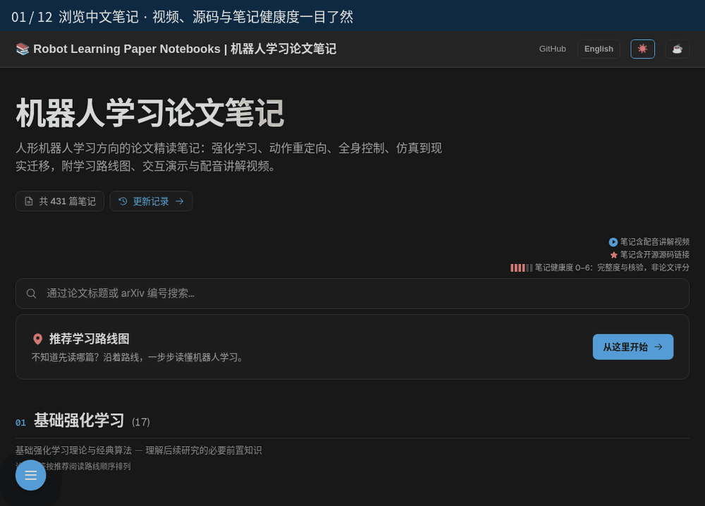

# Robot Learning Paper Notebooks

[简体中文](README.md) | **English**

In-depth reading notes on humanoid robot learning, covering reinforcement learning, motion retargeting, whole-body control, sim-to-real transfer, vision-language-action (VLA) models, and world models. The notes are primarily in Chinese.

## Live Demo

Follow the roadmap or search by paper title or arXiv ID. The notes explain methods, equations, and experimental results. Selected notes include animated explainers, narrated videos, and interactive experiments.

## Where to Start

| Your goal | Start here |
| --- | --- |
| Read papers in prerequisite order | [Learning roadmap](https://imchong.github.io/Robot_Learning_Paper_Notebooks/#roadmap-title) |
| Search or browse by topic | [Online paper index](https://imchong.github.io/Robot_Learning_Paper_Notebooks/) |
| Check recent updates and note completeness | [Update log](https://imchong.github.io/Robot_Learning_Paper_Notebooks/updates.html) · [Analytics](https://imchong.github.io/Robot_Learning_Paper_Notebooks/analytics.html) |
| See the paper list and reading progress | [Reading tracker](papers/PROGRESS.md) |

The paper list is based on [awesome-humanoid-robot-learning](https://github.com/YanjieZe/awesome-humanoid-robot-learning).

Licensed under [BSD 3-Clause](LICENSE). The local preview uses `baseurl = /Robot_Learning_Paper_Notebooks`. See [AGENTS.md](AGENTS.md) for build and maintenance instructions.
