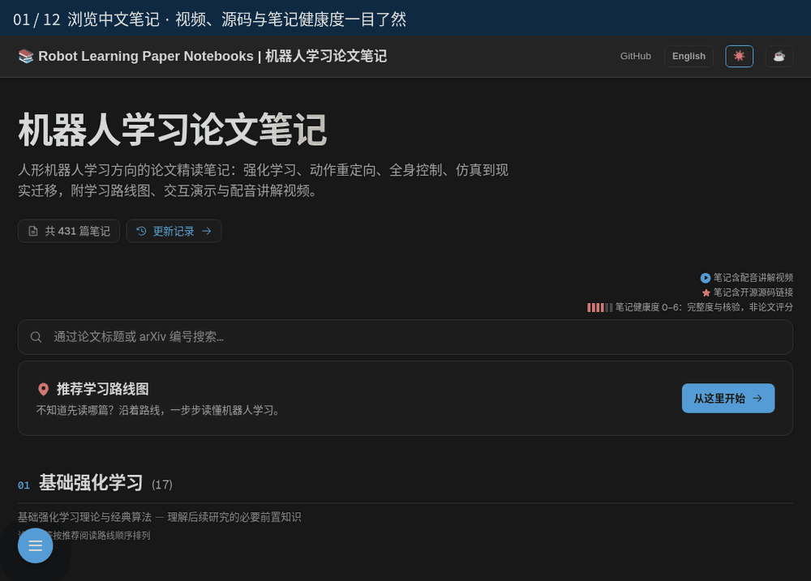

# 机器人学习论文笔记

**简体中文** | [English](README.en.md)

聚焦人形机器人学习的论文精读笔记，涵盖强化学习、动作重定向、全身控制、仿真到真机迁移，以及视觉–语言–动作（VLA）模型与世界模型。

## 在线演示

可以沿路线图阅读，也可以按论文标题或 arXiv 编号搜索。笔记详解方法、公式与实验结果，部分配有讲解动画、配音视频和交互实验。

## 从哪里开始

| 你的目标 | 入口 |
| --- | --- |
| 按先修关系阅读 | [学习路线图](https://imchong.github.io/Robot_Learning_Paper_Notebooks/#roadmap-title) |
| 搜论文或按主题浏览 | [在线论文目录](https://imchong.github.io/Robot_Learning_Paper_Notebooks/) |
| 看最新更新和笔记完整度 | [更新记录](https://imchong.github.io/Robot_Learning_Paper_Notebooks/updates.html) · [统计分析](https://imchong.github.io/Robot_Learning_Paper_Notebooks/analytics.html) |
| 查收录范围和阅读进度 | [论文阅读清单](papers/PROGRESS.md) |

论文目录以 [awesome-humanoid-robot-learning](https://github.com/YanjieZe/awesome-humanoid-robot-learning) 为基础。

项目采用 [BSD 3-Clause 许可证](LICENSE)。本地预览使用 `baseurl = /Robot_Learning_Paper_Notebooks`，构建与维护说明见 [AGENTS.md](AGENTS.md)。
