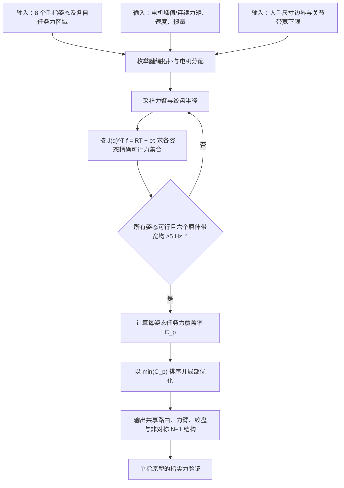

# PACT: Pose-Robust Actuation Co-Design for Tendon-Driven Robotic Hands
**PACT 把腱绳走线、关节力臂与绞盘半径放在同一个优化问题里，在多种手指姿态下最大化最弱姿态的任务力覆盖率，同时约束关节带宽。**

> 📅 总结日期: 2026-11-15
>
> 🏷️ 板块: 12 Hardware Design · 腱绳驱动 · 机构/驱动协同设计
>
> 🔁 推进轨: 独立模块轮转（11_Simulation_Benchmark → **12_Hardware_Design**）；本日按用户要求额外推进一篇

## 📋 基本信息

| 项目 | 内容 |
|---|---|
| 中文标题 | PACT：面向腱绳驱动机器人手的姿态鲁棒驱动协同设计 |
| 英文标题 | PACT: Pose-Robust Actuation Co-Design for Tendon-Driven Robotic Hands |
| 作者 | Prashant Kumar、Rachael Granberry、Taylor Niehues、Andrew A. Stanley、Gabe Pirie |
| 单位 | Meta Reality Labs Research |
| 首次发表 | 2026-11-03（arXiv v1，预印本） |
| 原文 | [arXiv 摘要](https://arxiv.org/abs/2611.05302) · [HTML v1](https://arxiv.org/html/2611.05302v1) · [PDF](https://arxiv.org/pdf/2611.05302) |
| 项目主页 | 未在已核对的原文中确认独立官方项目主页 |
| 开源源码 | 未在已核对的原文中确认官方实现仓库；故不绘制源码运行时序图 |
| 原文核验 | **done**：2026-11-15，通读可访问的官方 HTML v1 正文 I–IX 节、数学模型、实验、局限；PDF 链接存在但未另行下载逐页复核；未运行源码/复现实验 |

## ❓ 研究问题

人形手要求同时具备较大的指尖力、较快的关节响应、反驱性和人手尺寸。将电机移到手掌或前臂能减轻手指末端负担，但**腱绳跨越哪些关节、力臂多大、绞盘半径多大**共同决定力矩与速度；先选走线再选电机/传动，可能只在某个姿态满足需求，换姿态就失效。

## 🔧 核心方法

1. **姿态与任务力库**：选定 8 个代表性手指姿态，为每个姿态定义所需的三维指尖力区域；示例包含捏取、三指抓取、伸展与深度弯曲。
2. **精确可行力集合**：对每个姿态用指尖雅可比 `J(q)`、腱绳路由矩阵 `R` 和电机张力上界求可行集合；要求完整关节静力平衡 `J(q)^T f = RT + e_AA τ_AA`，而不是通过伪逆投影忽略无法匹配的力矩。
3. **驱动带宽约束**：考虑连续力矩、转速和电机转子反射惯量，分别计算 MCP/PIP/DIP 屈伸方向的单关节带宽，要求均不低于 **5 Hz**。这是模型预测带宽，不等于整手闭环实测带宽。
4. **跨姿态 max–min 优化**：同时选择路由符号、力臂与绞盘半径，最大化所有姿态中**最低**的任务力覆盖率。枚举可行拓扑、用 Sobol 采样与 Nelder–Mead 局部细化；该搜索是启发式，**不保证全局最优**。
5. **机械实现**：四自由度单指中，三个屈伸关节采用非对称 `N+1` 腱绳结构：一根高力矩共享腱绳配三根较小的差动腱绳；MCP 侧摆由独立双向执行器驱动。

### 方法流程图（依据论文 Fig. 1、III–V 节）

## 📊 实验与主要结论

- **仿真/模型评估**：八个姿态的任务力覆盖率为 **0.88–1.00**；共享设计最弱姿态覆盖率 **0.88**，对比任务无关的手工基线 **0.24**。六个屈伸方向的预测单关节带宽均达到 **5 Hz** 下限。
- **真实原型验证范围**：只在**一个姿态**进行指尖力实验，且执行器电流限为峰值力矩的 50%。测量力幅值较无摩擦预测最多低约 **24.5%**，方向误差 **14.82°**。
- **传动损失**：作者估计 MCP/PIP/DIP 的累积力矩损失约为 **14% / 24% / 32%**；将损失带回模型重新评分，最弱姿态覆盖率从 **0.88** 降至 **0.75**。这不是八个姿态全部经过实物测量的结果。

## 🧮 具体实例：为什么要最大化最弱姿态

以下仅使用论文报告的覆盖率指标做**可复算的解释**，不是新增实验，也不是原论文的逐姿态完整数据表。假设某个任务所需的指尖力区域体积为 **100 个归一化单位**；若某姿态可行力区域与需求区域交集体积为 **88**，按论文式 (19) 的覆盖率定义，`C=88/100=0.88`。若另一个设计只覆盖 **24**，则 `C=24/100=0.24`。两者在该示例中的覆盖率差为 **0.64**（64 个百分点），比值约 **3.67 倍**。这些 100、88、24 是教学归一化体积，不是作者测得的力空间体积；0.88 与 0.24 则是论文报告的两种设计的**最弱姿态**分数。

为什么不用八姿态平均分？设一个教学用设计 A 的 8 个姿态覆盖率为 `[1,1,1,1,1,1,1,0.24]`，其平均为 `7.24/8=0.905`，但最弱姿态只有 `0.24`。设设计 B 八姿态都是 `0.88`，平均仅 `0.88`，但最弱姿态 `0.88`。按论文的 max–min 目标，B 优于 A，因为同一只实体手指不能只在容易的姿态有力。这里 A/B 的逐姿态数组**完全是假设示例**，不是论文的测量或优化结果。

工程上还要区分**覆盖率**和**实际输出力**：论文报告的 24.5% 偏差来自单姿态实物力测试，不能直接把 `0.88×(1−0.245)` 当作真实覆盖率。作者在考虑传动损失后**重新计算力集合**，得到最弱姿态覆盖率 `0.75`，这才是论文的损失修正结果。

## ⚠️ 局限与阅读骨架

- **问题**：人体尺度下的腱绳手如何同时满足多姿态任务力与运动带宽？
- **方法**：精确静力可行集合 + 带宽约束 + 跨姿态最弱覆盖率最大化。
- **结果**：模型最弱覆盖率 0.24 → 0.88；单姿态原型揭示显著摩擦损失。
- **局限**：只验证一根手指；任务库固定为 8 个姿态；带宽未做整机闭环测量；优化忽略腱绳摩擦、柔顺、预紧、热限制等实际效应；搜索无全局最优保证。
- **后续阅读**：重点看式 (2)、(6)、(19)、(25) 如何将腱绳张力约束映射为任务力覆盖，并关注摩擦建模能否纳入下一轮机构协同优化。

## 📚 来源与核验边界

- 一手资料：[官方 arXiv HTML v1](https://arxiv.org/html/2611.05302v1)，核对 I–IX 节、Fig. 1–6、表 I–II 及原文报告的指标（2026-11-15）。
- [官方 PDF](https://arxiv.org/pdf/2611.05302) 链接已记录，但本次未下载并独立逐页核对。
- 未确认官方代码仓库；因此**不提供源码时序图**，不声称完成源码审计、原型复现或带宽实测。
