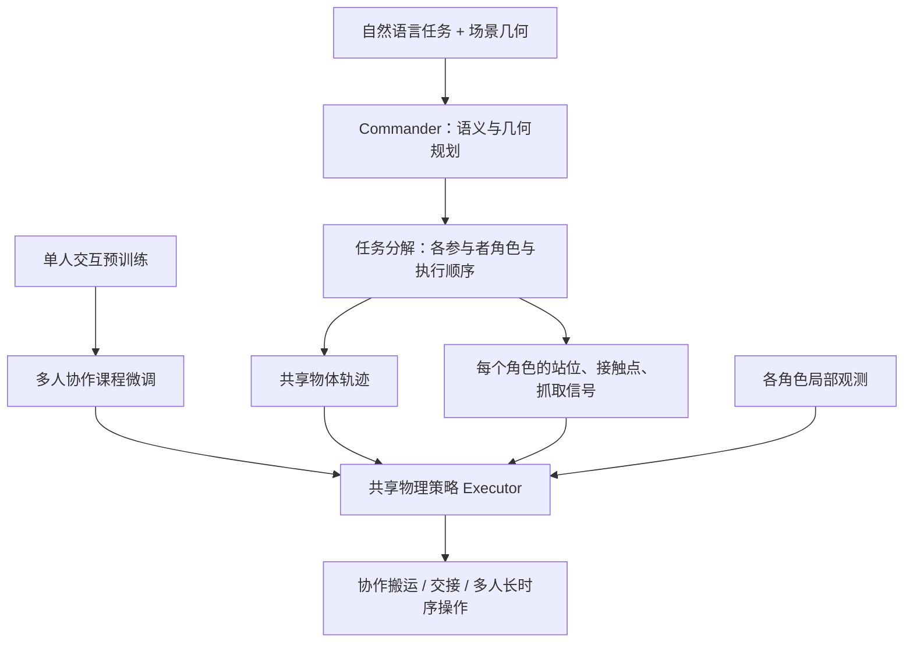

# Scalable Multi-Human Cooperative Manipulation via Commander-Executor Coordination
**以 Commander 生成共享物体轨迹、角色分工和抓取时序，再由共享物理策略 Executor 通过从单人到多人的课程学习执行长时序协作操作。**

> 📅 总结日期: 2026-11-16
>
> 🏷️ 板块: 13 Physics-Based Animation · 多人协作 · 物理控制
>
> 🔁 推进轨: 独立模块轮转（12_Hardware_Design → **13_Physics-Based_Animation**）

## 📋 基本信息

| 项目 | 内容 |
|---|---|
| 英文标题 | Scalable Multi-Human Cooperative Manipulation via Commander-Executor Coordination |
| 中文标题 | 基于指挥者与执行者协同的可扩展多人合作操作 |
| 作者 | Buzhen Huang、Xingchen Wu、Yuanwang Yang、Chenyi Xie、Kun Li |
| 机构 | 天津大学（Tianjin University） |
| 发表 | arXiv 预印本，首次提交 2026-10-10 |
| 原文 | [arXiv](https://arxiv.org/abs/2610.14911) · [PDF](https://arxiv.org/pdf/2610.14911) · [HTML](https://arxiv.org/html/2610.14911) |
| 论文图表 | [可访问的图表及表格镜像](https://thelatestinai.com/papers/2610.14911) |
| 源码 | 论文摘要注明将于 [TJU-3DV/Co-Manipulation](https://github.com/TJU-3DV/Co-Manipulation) 公开；**未核实到已发布的可审阅实现** |
| 原文核验 | **partial**（2026-11-16）：已核对 arXiv 摘要与图 1–6、表 I–III 的公开镜像；官方 PDF/HTML 全文无法访问，**未通读全文**，不得视为 done |

## ❓ 研究问题

现有物理驱动的人物-物体交互策略常能完成简单的双人搬运，却难以处理需要**不同角色、交接顺序、连续多件物品**的长时序任务。直接训练多智能体物理策略还会遭遇复杂接触和样本效率问题。

## 🔧 方法核心

1. **Commander（高层）**：输入自然语言任务与场景几何，联合进行语义与几何规划；把任务分解为各参与者的角色子任务。
2. **物体中心协同计划**：产生共享的物体轨迹，并给出各角色的站位、接触位置与抓取/释放信号。物体轨迹使多人围绕同一目标同步，而角色提示允许分工。
3. **Executor（低层）**：共享物理策略读取高层计划及各自局部观测，产生协调的全身交互动作；从单人预训练逐步转向多人协作微调。
4. **任务组合**：将协作搬运、接力式交接与多角色操作组合为长时序任务。这里仅描述论文摘要与图 1–3、6 可核实的结构，不推断未读正文中的网络结构或训练超参数。

### Mermaid 方法流程图（依据摘要与图 1–3）

## 📊 实验与贡献（仅限已核对图表）

可访问的论文表 I 显示，在 Core4D-Trajectory 测试下，作者方法成功率 **80.26%**，对照 CooHOI **39.47%**；在 Bezier-Trajectory 测试下分别为 **86.50%** 和 **35.42%**。这些是论文报告值，尚未独立复现实验。

表 II 给出两种场景的连续搬运：平均单阶段成功率 SSR **95.83%**，连续完成 1、2、3 件物品的 CSR 分别为 **91.67% / 81.95% / 66.67%**。连续任务越长，成功率越低，不能把单阶段成功率当成完整任务成功率。

表 III 的消融显示，去掉单人预训练或多人微调后，表内成功率为 **0**；去掉物体轨迹后，表内成功率记录为 **0.170**（原表原样保留，因其与其他行的数值尺度可能不同，未读正文前不擅自换算）。图 5 说明跳过单人预训练会使多智能体训练更不稳定。

## ⚠️ 局限与阅读骨架

- **研究问题**：如何让多人协作完成角色分工明确、跨多个物体的长时序操作？
- **核心方法**：Commander 规划共享物体目标与角色提示，Executor 通过单人到多人课程学习物理控制。
- **结果**：公开表格显示相较所列基线更高的成功率，连续多件任务仍有累积失败。
- **局限**：目前笔记只核对摘要、图表而未通读正文；真实机器人部署、仿真设置、训练超参数、统计置信度与计算成本尚待核验；源码未能审阅，**不绘制源码时序图**。
- **下次补全**：在可访问 PDF/HTML 全文后逐节核对方法、附录、实验设置、指标定义与局限，再将 `original_check` 升级为 `done`（如确实通读）。

## 📚 来源与核验边界

2026-11-16 查验：[arXiv 论文页](https://arxiv.org/abs/2610.14911) 的作者、首次发表时间和摘要；[论文图表镜像](https://thelatestinai.com/papers/2610.14911) 的图 1–6、表 I–III。官方 HTML/PDF 获取失败；因此本稿属于**原文部分核验的简明笔记**，不是全文精读，也未核验源码入口/训练/推理实现。
